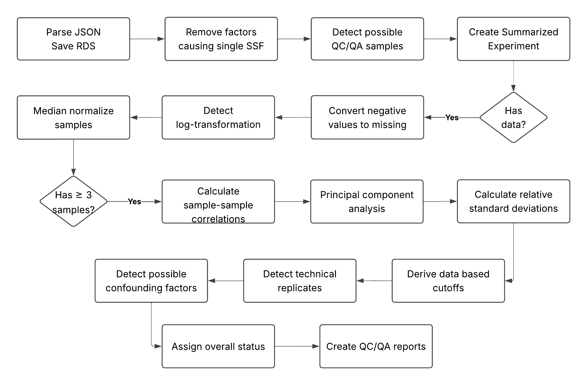

```{r}
#| label: knitr-chunks
#| echo: false
knitr::opts_chunk$set(
  echo = FALSE,
  message = TRUE,
  warning = FALSE,
  fig.width = 14,
  fig.height = 12,
  # fig.process = figure_count$modify_path,
  dev = "png",
  dpi = 150
)
```

```{r}
#| label: load-targets
#| message: false
#| warning: false
library(targets)
tar_source(c("packages.R", "R"))
tar_load(c(
  # analysis pieces
sets_qc_color_confounds,
potential_confound_info,
technical_replicate_info,
rsd_modes_all,
not_gray_pca,
# plots
nose_reasons_bar_plot,
loss_waterfall_plot,
datasets_sizes_plot,
mmr_logtransform_plot,
status_heatmap_top90_plot,
technical_replicates_plot,
total_vs_tr_rsd_plot,
example_confound_plot_454,
example_confound_plot_6863,
negatives_as_missing_plot,
non_technical_rsd_plot,
percent_missingnes_plot,
data_based_cutoffs_plot,
# tables
study_status_comparison_table,
negatives_as_missing_table
))
```

## Omics Data Repositories

- Journals and funders now require processed data to be deposited in a repository.
- Many support the deposition of raw data in addition to processed data.
- General repositories:
  - Data dryad
  - Zenodo
  - Figshare
- Specific repositories:
  - Gene expression omnibus (GEO): microarrays, gene expression
  - Sequence read archive (SRA): next-gen sequencing
  - Metabolights: metabolomics
  - Metabolomics Workbench: metabolomics

## Metabolomics Workbench

#### Why?

- Because we have a lot of experience downloading, uploading, parsing their files

#### Stats

- Started in XXXX
- Organized by
  - Project: a biological question, contains 1 or more studies
  - Study: further narrowed (maybe), contains 1 or more analyses
  - Analysis: one anlysis method or sample type, NMR, MS + chromatography, +ve / -ve mode, etc
- Currently hosts 4261 studies
- We downloaded **7240 analyses** on 2026-07-21

## What Does Good Data Look Like?

- Well defined experimental groups with a good number of replicates in each group
- Sufficient metadata for samples and metabolites
- Not too many missing values
- 

## Pipeline

:::: {.columns}

::: {.column width="30%"}
- 7240 datasets
- grouped into 37 sets
- 5 days of computation
- 6900 lines of R
- 230 custom functions
- all managed by `targets`
:::

::: {.column width="70%"}

:::

::::


