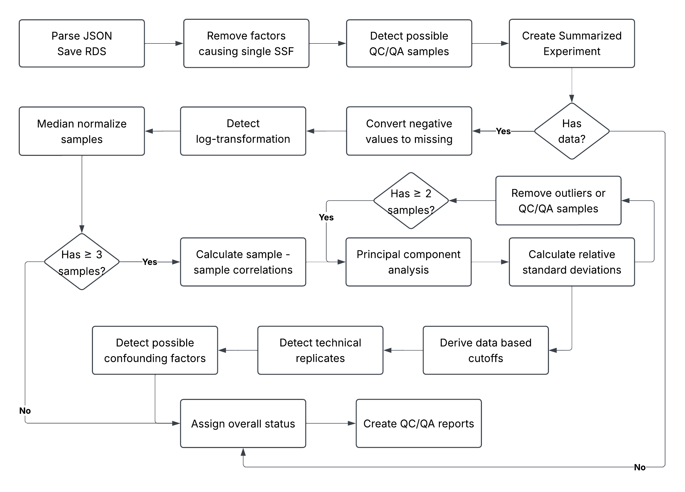

```{r}
#| label: knitr-chunks
#| echo: false
knitr::opts_chunk$set(
  echo = FALSE,
  message = TRUE,
  warning = FALSE,
  fig.width = 9,
  fig.height = 6,
  # fig.process = figure_count$modify_path,
  dev = "png",
  dpi = 300
)
```

```{r}
#| label: load-targets
#| message: false
#| warning: false
library(targets)
tar_source(c("packages.R", "R"))
tar_load(c(
  # analysis pieces
sets_qc_color_confounds,
potential_confound_info,
technical_replicate_info,
rsd_modes_all,
not_gray_pca,
# plots
nose_reasons_bar_plot,
loss_waterfall_plot,
datasets_sizes_plot,
mmr_logtransform_plot,
status_heatmap_top90_presentation_plot,
technical_replicates_plot,
total_vs_tr_rsd_plot,
example_confound_plot_454,
example_confound_plot_6863,
negatives_as_missing_plot,
non_technical_rsd_plot,
percent_missingnes_plot,
data_based_cutoffs_plot,
example_raw_log_plot,
count_nmostcommon_barplot,
pca_example_green_1,
pca_example_green_2,
pca_example_green_3,
# tables
study_status_comparison_table,
negatives_as_missing_table
))
```

## Omics Data Repositories

- Journals and funders now require processed data to be deposited in a repository.
- Many support the deposition of raw data in addition to processed data.
- General repositories:
  - Data dryad
  - Zenodo
  - Figshare
- Specific repositories:
  - Gene expression omnibus (GEO): microarrays, gene expression
  - Sequence read archive (SRA): next-gen sequencing
  - Metabolights: metabolomics
  - Metabolomics Workbench: metabolomics

## Metabolomics Workbench

#### Why?

- Because we have a lot of experience downloading, uploading, parsing their files

#### Stats

- Started in XXXX
- Organized by
  - Project: a biological question, contains 1 or more studies
  - Study: further narrowed (maybe), contains 1 or more analyses
  - Analysis: one anlysis method or sample type, NMR, MS + chromatography, +ve / -ve mode, etc
- Currently hosts 4261 studies
- We downloaded **7240 analyses** on 2026-07-21

## What Does Good Data Look Like?

- Well defined experimental groups with a good number of replicates in each group
- Sufficient metadata for samples and metabolites
- Not too many missing values
- 

## QC/QA Pipeline

:::: {.columns}

::: {.column width="30%"}
- 7240 datasets
- grouped into 37 sets
- 5 days of computation
- 6900 lines of R
- 230 custom functions
- all managed by `targets`
:::

::: {.column width="70%"}

:::

::::


## Reasons Datasets "Fail"

```{r}
#| label: loss-plot
#| fig-cap: "Waterfall loss plot showing how many datasets were initially processed (7240), and then how many were removed as the analysis progressed along each stage. No Data: -167; < 3 Samples: -622; < 3 Samples After Correlation: -5; Gray PCA: -247; Analyzed: 6199."
loss_waterfall_plot
```

## No Data??

```{r}
#| label: nodata-reasons
#| fig-cap: Counts of the various reasons that the 167 datasets had "No Data", and therefore couldn't create a summarized experiment object to be used for further analysis.
nose_reasons_bar_plot
```

## Detection of Log-Transformation

```{r}
#| label: raw-log-histograms
#| fig-cap: Histogram of abundances in "raw" space and log-transformed, with the mean and median locations indicated.
example_raw_log_plot
```

::: {.fragment style="position: absolute; bottom: 400px; right: 120px; font-size: 2em; color:black;"}
Mean - median ratio (MMR)
:::

## Detection of Log-Transformation


```{r}
#| label: mmr-plot
#| fig-cap: "All plots used datasets with an MMR >= 0.2 and MMR <= 200. **A**: Histogram of Log10(MMR). **B**: Log10(MMR) vs fraction of negative data values, after excluding all datasets with zero negative values. **C**: Histogram of Log10(MMF) for datasets with a maximum observed intensity <= 1000. Vertical lines indicate the MMR cutoffs used of 0.8 (-0.097 on log10 scale) and 1.2 (0.079 on log10 scale) to decide that a dataset should undergo exponentiation."
(mmr_logtransform_plot$mmr_distribution / (mmr_logtransform_plot$mmr_vs_neg | mmr_logtransform_plot$less1000)) + plot_annotation(tag_levels = "A")
```

## Negative & Missing Values

* MMR and transformation change only a fraction of datasets
* Negative valuse withough log-transformation should be physically impossible?
* What if we treat negative values as missing?

## Color Grade Evaluation

* Number of samples within each subject-sample-factor (SSF);
* Percent missingness;
* Left-censorship test;
* Maximum median ICI-Kt correlation;
* Relative-standard deviation (RSD);
* Principal components accounting for 90% of the variance;
* ANOVA test of SSF to PC scores;

## Overall Color Status

```{r}
#| label: status-colors
color_status = sets_qc_color_confounds |>
  dplyr::filter(
    completed_steps %in% "se; dynamic_range; correlation; pca",
    !overall_status %in% "gray"
  )
n_color = summarize_status(color_status)
tmp_color = n_color |>
  dplyr::transmute(`Overall Status` = overall_status, N = n, `%` = perc_display)

display_color = tibble::tibble(`Overall Status` = c("green", "yellow", "red"))
display_color = dplyr::left_join(display_color, tmp_color, by = "Overall Status")
display_color |>
  gt::gt()
```

## Overall Status

```{r}
#| label: status-heatmap
#| fig-width: 18
#| fig-height: 9
#| fig-cap: Top 90% of status combinations. 
status_heatmap_top90_presentation_plot
```


## Yellow: N-Samples

```{r}
#| label: count-mostcommon-barplot
#| fig-cap: Counts of the most frequently observed number of samples per SSF group in each dataset, with the bar colored by which color status that corresponds to.
count_nmostcommon_barplot
```

## Red: PCA ANOVA P-Value

- Principal component analysis (PCA) sample scores tested against SSF groups.
- Easy way to test if there is the expected separation of SSF groups in PCA plots.

::: {.r-stack}

::: {.fragment width="600" height="400"}

```{r}
#| label: pca-green-1
#| fig-width: 6
#| fig-height: 4
pca_example_green_1
```

:::

::: {.fragment width="600" height="400"}

```{r}
#| label: pca-green-2
#| fig-width: 6
#| fig-height: 4
pca_example_green_2
```

:::

:::


## Next Slide

- Just a placeholder so we always see what happens on the next hit.